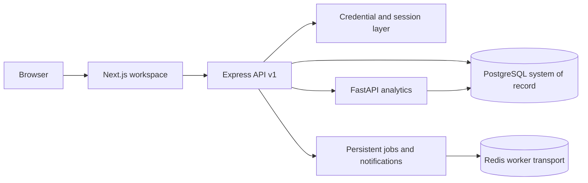

# Initial Architecture

WorkSphere is a monorepo with three deployable services. The Next.js web application is the browser interface. The Express API is the future owner of transactional business workflows and is the only service planned to write core tenant data. FastAPI is a separate processing and analytics service; it must not become an alternative source of truth for business entities.

```text
Browser -> Next.js web -> Express API -> PostgreSQL
                                  -> Redis
Express API -> FastAPI analytics -> PostgreSQL (read-oriented, later phase)
                                -> Redis
```

PostgreSQL is the system of record. The Phase 1 Prisma migration establishes `organizations` as the first tenant root. Later migrations will add memberships and tenant-owned records with foreign keys, indexes, authorization checks, and transaction boundaries. Redis is reserved for cache and job coordination; no jobs are implemented yet.

`/health` is a liveness endpoint that does not require dependencies. `/ready` performs real PostgreSQL and Redis checks and returns HTTP 503 when either is unavailable. This distinction avoids falsely declaring a service ready during dependency failure.

Configuration is environment-driven and validated by the Node API. `.env.example` contains only safe placeholders. Docker Compose keeps PostgreSQL and Redis off host ports; only application HTTP ports are published for local development.

## Current domain boundary



The API owns users, organization membership, projects, tasks, comments, attachment metadata, activity records, invitations, sessions, notification outbox rows and webhook event deduplication. FastAPI consumes bounded task snapshots and must not write business entities. The console email adapter and attachment metadata endpoint are explicit local/demo implementations; production deployments must configure a real mail/storage adapter and a worker.

Task changes require the caller's current version. An update uses an atomic `id + version` condition; a zero-row update returns `409 VERSION_CONFLICT`, preserving activity history and preventing a silent overwrite.
